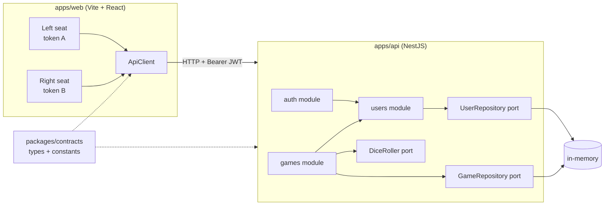

# Architecture — Dice Game

Implements [requirements.md](requirements.md). Terms per [GLOSSARY.md](../GLOSSARY.md). ADRs: [0001](adr/0001-username-only-authentication.md), [0002](adr/0002-domain-errors-mapped-by-global-filter.md).

Diagrams from high level to low level: [diagrams/](diagrams/README.md) (interactive version: [diagrams/index.html](diagrams/index.html)).

## Context



## Folder tree

```
apps/
  api/src/
    main.ts                      # ValidationPipe, CORS, DomainExceptionFilter
    app.module.ts                # ConfigModule (JWT_SECRET)
    shared/domain-error.ts       # DomainError base
    shared/domain-exception.filter.ts
    auth/
      application/auth.service.ts        # login → find-or-create User → sign JWT
      infrastructure/jwt.strategy.ts, jwt-auth.guard.ts
      presentation/auth.controller.ts, login.dto.ts
    users/
      domain/user.ts, user.repository.ts (port), username.ts
      infrastructure/in-memory-user.repository.ts
      presentation/users.controller.ts   # GET /users/me
    games/
      domain/game.ts, player.ts, dice-roller.ts (port), game.repository.ts (port), errors.ts
      application/games.service.ts       # create, roll, hold, get → GameView
      infrastructure/in-memory-game.repository.ts, random-dice-roller.ts
      presentation/games.controller.ts, create-game.dto.ts, to-game-state-dto.ts
    test/*.e2e-spec.ts
  web/src/
    api/client.ts                # fetch wrapper, token passed per call
    seats/SeatContext.tsx        # { left, right } → { token, user }
    hooks/useGame.ts             # TanStack Query: query + roll/hold/create mutations
    components/                  # presentational: Board, PlayerPanel, Dice, LoginForm, NewGameForm, BustBanner
    containers/                  # GameContainer, SeatContainer
packages/contracts/src/          # auth.ts, game.ts, error.ts (built to dist/ for the API)
```

Dependency rule: `presentation → application → domain`; `infrastructure` implements domain ports. `domain/` imports nothing from Nest.

## Domain model

**Game** (aggregate root): `id`, `players: [Player, Player]`, `currentIndex`, `status`, `winningScore`, `winnerId`, `lastRoll`.
**Player** (entity inside Game): `userId`, `globalScore`, `roundScore`.
**User** (aggregate): `id`, `username` (normalised lowercase), `winCount`; `recordWin()`.

Game methods return results; they never perform I/O:
- `Game.create(creatorId, opponentId, winningScore = 100)`
- `roll(userId, dice: [n, n]) → { bust }`
- `hold(userId) → { won: boolean }`
- `abandon()`

Invariants (enforced in `Game`):
1. Exactly 2 Players with distinct Users (`SelfPlayError`).
2. `10 ≤ winningScore ≤ 1000`, integer (`InvalidWinningScoreError`).
3. Only the current Player may roll or hold (`NotAPlayerError` / `NotYourTurnError`).
4. Roll and hold require `IN_PROGRESS` (`GameNotInProgressError`).
5. Dice 6 & 6 → `roundScore = 0`, Turn passes. Otherwise `roundScore += d1 + d2`.
6. Hold → `globalScore += roundScore`, `roundScore = 0`. If `globalScore ≥ winningScore`, the Game is `WON` with `winnerId` set and no Turn pass. Otherwise the Turn passes.
7. `abandon()`: `IN_PROGRESS` becomes `ABANDONED`, with no winner.

**Bot** (domain): the system User `bot`, plus a `BotStrategy` port: `decide(state) → 'ROLL' | 'HOLD'`. The default `HoldAtTwentyStrategy` Holds when `roundScore ≥ 20` or when Holding would Win. A `BotPlayer` domain service runs one Bot Turn against `Game` (using the same `roll`/`hold` methods) and returns `BotStep[]` (`{ kind: 'ROLL', dice, bust } | { kind: 'HOLD', won }`).

Application (`GamesService`):
- **create:** abandon each User's active Game, then save the new one.
- **hold:** if `won`, call `users.recordWin(winnerId)` in the same call. There is no event bus.
- **Bot Turn:** after a human Hold (not Won) or Bust, if the current Player is `bot`, run `BotPlayer` in the same call, record a Bot Win if it happens, and save once. The steps go into `GameStateDto.botSteps` (empty otherwise). R8's abandon skips `bot` (ADR 0003).

## API

All routes except login require `Authorization: Bearer <jwt>`.

| Method | Path | Body | 200/201 | Errors |
|---|---|---|---|---|
| POST | `/auth/login` | `LoginRequest` | `LoginResponse` | 400 |
| GET | `/users/me` | – | `UserDto` | 401 |
| POST | `/games` | `CreateGameRequest` | `GameStateDto` | 400, 401 |
| GET | `/games/:id` | – | `GameStateDto` | 401, 403, 404 |
| POST | `/games/:id/roll` | – | `GameStateDto` | 401, 403, 404, 409 |
| POST | `/games/:id/hold` | – | `GameStateDto` | 401, 403, 404, 409 |

Every mutation returns the full `GameStateDto` (see `packages/contracts/src/game.ts`).

## Errors

Shape is always `ApiErrorDto { statusCode, error, message }`.

| Source | Status |
|---|---|
| `ValidationPipe` (DTO shape, username format) | 400 |
| `InvalidWinningScoreError`, `SelfPlayError` | 400 |
| Missing or invalid JWT (guard) | 401 |
| `NotAPlayerError`, `NotYourTurnError` | 403 |
| `GameNotFoundError` | 404 |
| `GameNotInProgressError` | 409 |

## Frontend data flow

The two seats each hold `{ token, user }` in `SeatContext`. The board renders one `GameStateDto` from `useQuery(['game', id])`. Roll and Hold mutations use the token of the seat whose `user.id === currentPlayerId`. Each mutation's response is written into the cache with `setQueryData`, so there's no refetch. Buttons are enabled from `currentPlayerId` alone; the UI makes no rule decisions. `lastRoll.bust` triggers the 1.5s `BustBanner` lock.

Bot replay: when a response has `botSteps`, `useBotReplay` keeps the previous board state and plays each step (thinking indicator 600–1200 ms → dice → score/banner), then shows the server's final state, including the win overlay. Controls are locked during the replay; Space or a click skips to the final state. No requests are made during the replay.

## Slices for /developer

| # | Slice | Done when |
|---|---|---|
| S0 | Scaffold: npm workspaces, Nest + Vite apps, contracts wired, lint/tsc/test scripts | `npm run build` and `npm test` pass on empty apps |
| S1 | Domain `Game`/`Player`/`User` + errors + unit tests (fake DiceRoller) | Invariants 1–7 covered |
| S2 | Auth: login, JWT strategy/guard, users module, `/users/me` | e2e: AC1.x |
| S3 | Games API + `DomainExceptionFilter` + e2e (seeded dice) | e2e: AC2–AC8 |
| S4 | Web shell: ApiClient, SeatContext, two login seats | Both seats log in |
| S5 | Game board: New Game form, scores, dice, Roll/Hold, winner | Full game playable in browser |
| S6 | Extras: Win Count display, Bust lock banner | AC8.2, AC9.x |
| S7 | Bot opponent: `bot` User + login block, `BotStrategy`/`BotPlayer` + unit tests, `botSteps` in contracts and API, "vs Bot" in the New Game form, `useBotReplay` with thinking animation | e2e AC10.1–10.6 (seeded dice), UI AC10.7–10.9 |
| S8 | Sound (story S11): `soundFor` maps Roll/Hold events, human or replayed Bot steps, to a sound. `SoundPlayer` port with a WebAudio player that synthesises sounds (no files). Win plays with the win overlay. Mute toggle in TopBar saved in localStorage | Unit: `soundFor`, mute preference; manual smoke with sound on and off |
