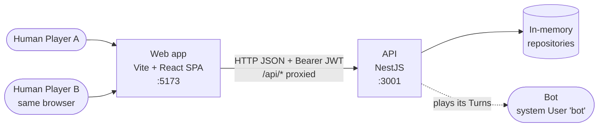
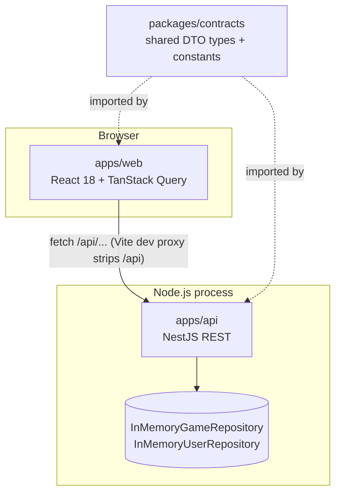
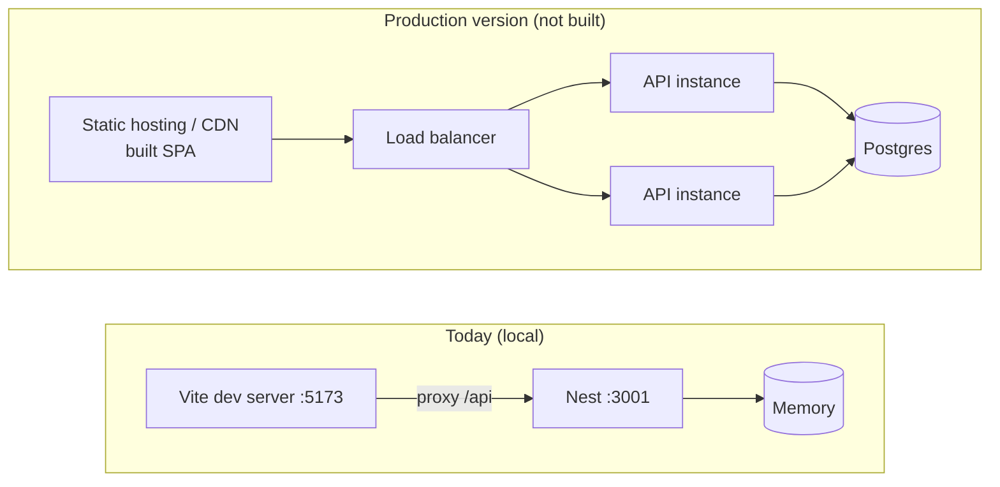

# 1. HLD — System context and containers

## Context

Two people share one browser (hot-seat), or one person plays the Bot. Everything runs locally; there is no external service.

## Containers

| Container | Tech | Holds state? |
|---|---|---|
| `apps/web` | Vite, React, TanStack Query | Seats (tokens) in React context; server state in the Query cache. Lost on reload by design. |
| `apps/api` | NestJS, Passport JWT, class-validator | All game state, in memory. Lost on API restart. |
| `packages/contracts` | TypeScript types only | No. It is the single REST contract both sides compile against. |

## Infrastructure today vs a production version

Today: `npm run dev` starts both apps with `concurrently`. There is no database, container or cloud setup (by choice, see the scope table in the README).

Only the infrastructure layer would change for production: a `PostgresGameRepository` / `PostgresUserRepository` implementing the same ports. Multiple API instances need shared storage, because state is in memory today. Next: [02-components.md](02-components.md).
