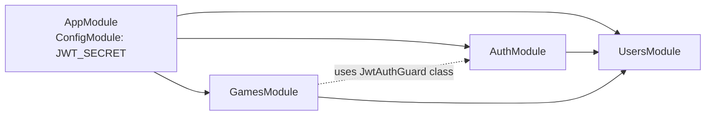
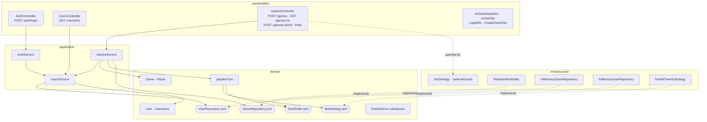
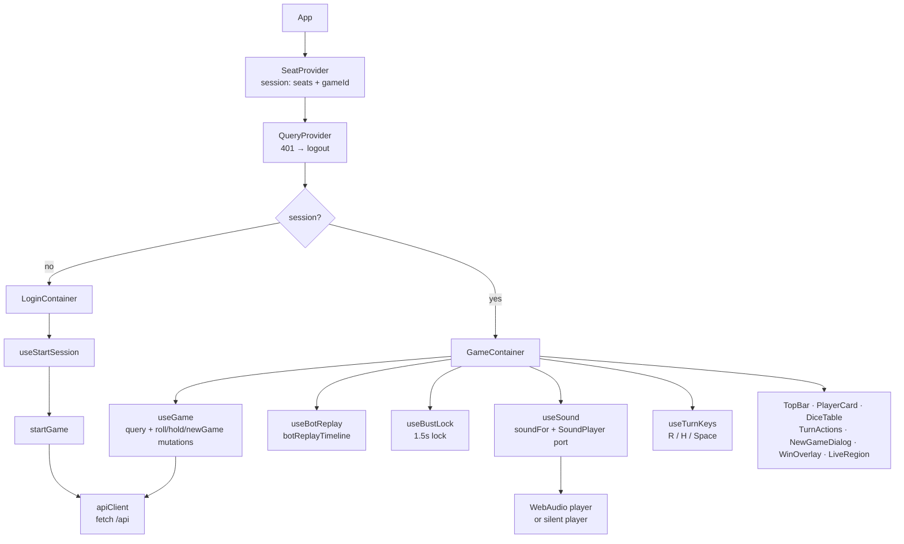

# 2. Components — modules and layers

## API: NestJS modules

`configureApp()` (shared by `main.ts` and the e2e tests) installs a global `ValidationPipe` and the global `DomainExceptionFilter`.

## API: DDD layers inside each module

Dependency rule: `presentation → application → domain`. `infrastructure` implements domain ports. `domain/` imports nothing from Nest.

`HoldAtTwentyStrategy` lives in `domain/bot-strategy.ts` (it is pure rules); it sits in the infrastructure box only as the bound implementation.

## Web: React structure

Presentational components render only `GameStateDto`; the UI makes no rule decisions.

| Concern | Where | Note |
|---|---|---|
| Which token acts | `seatFor(session, currentPlayerId)` in `useGame` | Each seat has its own JWT; the API decides whose Turn it is. |
| Server state | TanStack Query cache `['game', id]` | Every mutation response replaces it (`setQueryData`); no refetch. |
| Bot Turn | `useBotReplay` | Replays `botSteps` as frames, then `refresh()` ([ADR 0003](../adr/0003-bot-turn-decided-on-server-replayed-on-client.md)). |
| Polish | `useBustLock`, `useSound`, `announce` | Presentational only; the API never knows about them. |

Next: [03-flows.md](03-flows.md).
