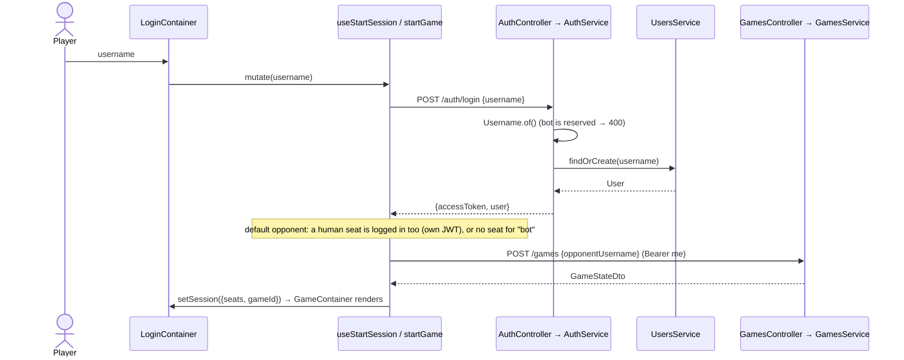
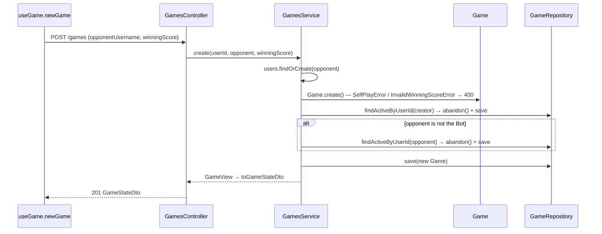
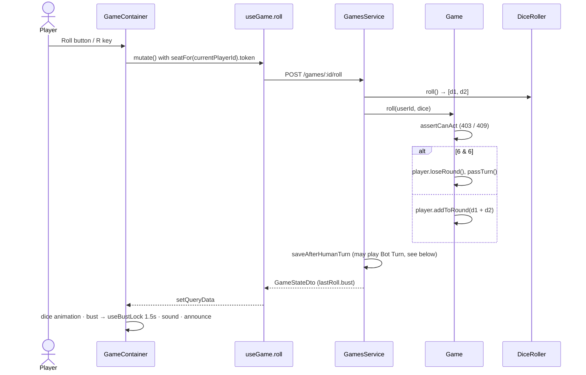
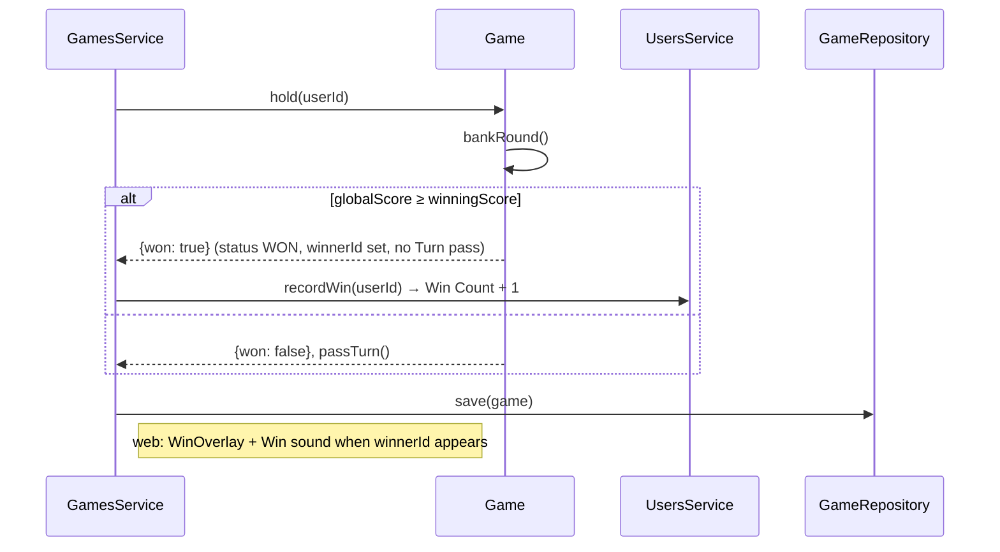
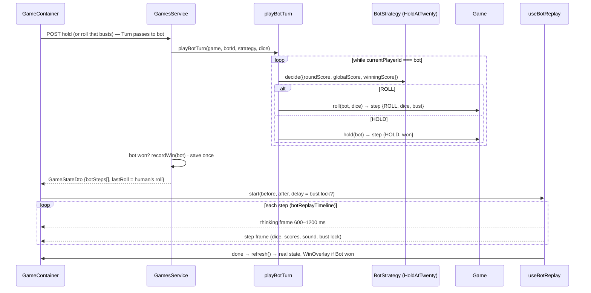
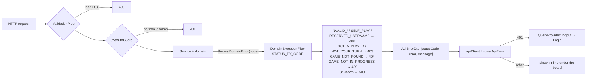

# 3. LLD — Request flows

Every mutation returns the full `GameStateDto`; the web app replaces its cache with it. Names match the code.

## Login (and the default Game)

## New Game (abandons active Games)

## Roll (including Bust)

## Hold → Win

## Bot Turn — decided on the server, replayed on the client

See [ADR 0003](../adr/0003-bot-turn-decided-on-server-replayed-on-client.md).

Controls stay locked during the replay. Space or a click skips to the end. No requests are made while it plays.

## Error path

See [ADR 0002](../adr/0002-domain-errors-mapped-by-global-filter.md). Next: [04-domain-model.md](04-domain-model.md).
