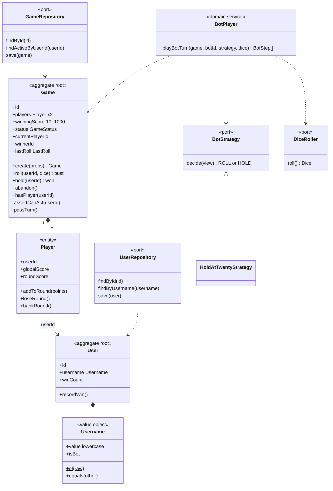
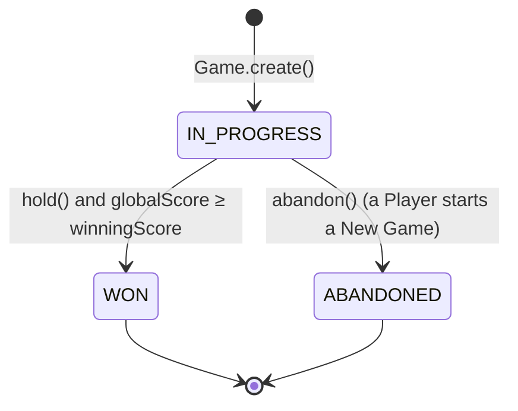
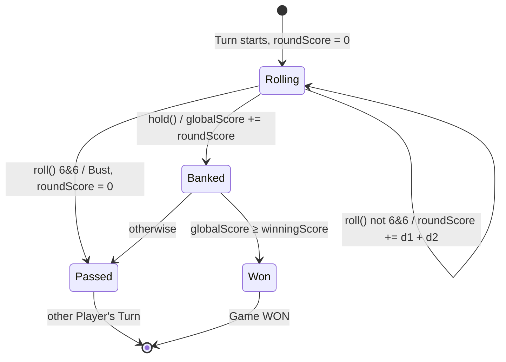

# 4. LLD — Domain model

## Classes and ports

Game methods return results and never do I/O. The application service saves the Game and records Wins.

## Game lifecycle

## A Turn

## Invariants (enforced in `Game`)

| # | Rule | Error → HTTP |
|---|---|---|
| 1 | Exactly 2 Players, distinct Users | `SelfPlayError` → 400 |
| 2 | Winning Score is an integer 10–1000 | `InvalidWinningScoreError` → 400 |
| 3 | Only a Player, and only the current one, may act | `NotAPlayerError` / `NotYourTurnError` → 403 |
| 4 | Roll and Hold need `IN_PROGRESS` | `GameNotInProgressError` → 409 |
| 5 | 6 & 6 loses the Round Score and passes the Turn | — |
| 6 | Hold banks; a Win ends the Game without passing the Turn | — |
| 7 | Abandon ends an active Game with no winner | — |
